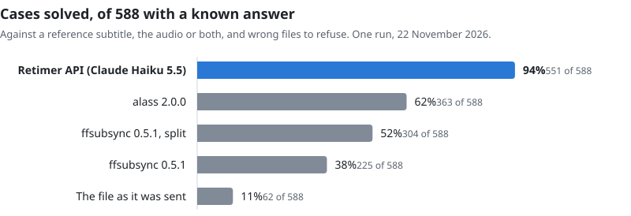

# subtitle-retimer

A self-hosted service that fixes the timing of subtitles. Give it a subtitle
that is out of sync and a reference (a subtitle track of the video that is in
sync, the video's audio, or both), and it hands back the subtitle in sync.

A model decides what is wrong with a file, and code does all of the timing
math, so a model's answer can never move a line by a number it made up. It is
built for the Jellyfin plugin
[Subtitle Retimer](https://github.com/friedrich-de/jellyfin-subtitle-retimer), and
any client can use it over HTTP or on the command line.

<picture>
  <source media="(prefers-color-scheme: dark)" srcset="docs/benchmark-dark.svg">
  
</picture>

## How it compares

[alass](https://github.com/kaegi/alass) and
[ffsubsync](https://github.com/smacke/ffsubsync) are the best-known tools for
this. All three ran on the same 588 cases of the benchmark, each with
a known right answer. A case is solved when 95% of its lines start within
250 ms of where they belong, or, for the wrong file, when it is refused or
left alone.

| The case gives | Cases | Retimer API | alass | ffsubsync, split | ffsubsync |
| --- | --- | --- | --- | --- | --- |
| A subtitle that is in sync | 380 | **98%** | 85% | 66% | 49% |
| The audio | 116 | **74%** | 0% | 21% | 11% |
| A subtitle and the audio | 46 | **100%** | 87% | 63% | 57% |
| A wrong file, to refuse or leave alone | 46 | **100%** | 0% | 0% | 0% |

- **It knows which line is which.** alass and ffsubsync line up the rhythm of
  the lines with the reference. The retimer matches lines by what they say,
  also from Japanese to English, so episode packs, scenes cut in the middle,
  cold opens and karaoke scripts do not throw it. Against a subtitle it solves
  52 cases that alass does not, and alass 2 that it does not.
- **It works from the audio.** It matches the lines to a transcript of the
  speech. On the two films of the benchmark alass misses every audio case,
  and ffsubsync with `--split-penalty` solves a fifth.
- **It says no.** Given another film, the next episode or a track of signs and
  songs only, it refuses or leaves the file alone. alass and ffsubsync move
  the file in every one of those cases.

**On real files** it was measured too, on 1,027 Japanese subtitle files from
Jimaku against the subtitle tracks of their anime episodes and films. Nobody
timed those by hand, so two automatic checks judge them: one against the
episode's own track, which favours the retimer, and one that listens for the
voices.

| | Against the episode's track | Against the voices |
| --- | --- | --- |
| **Retimer API** | **95%** | **97%** |
| alass, tuned on that set | 80% | 93% |
| ffsubsync, tuned on that set | 68% | 83% |

It refused 123 of 125 files for another episode or series, where alass and
ffsubsync moved every one they could read.

The made cases are the problems this project set out to solve, and alass and
ffsubsync ran on them with their defaults. They take one reference, so where a
case gives a subtitle and the audio they got the subtitle. Every audio case is
from two English films. The full runs, with all their limits:
[the benchmark](bench/baselines/2026-11-22-head-to-head.md) and
[the real files](bench/baselines/2026-11-18-real-files.md).

## What it handles

- **Offsets, frame rates and cuts.** A file that is early or late, one made for
  a 25 fps release, one made for a release with other cuts, ad breaks or
  recaps, each part moved by its own amount.
- **Stretches that drift**, as captions of a TV broadcast do.
- **Files of several episodes**, cut down to the episode the reference covers.
- **The wrong file.** The next episode of a series, or another film, is refused
  instead of being forced onto the video.
- **Several reference tracks.** A video often has many subtitle tracks: songs
  and signs only, another language, captions for the hearing impaired. The
  service picks the one that fits and says why.
- **Fansub scripts** in ASS with karaoke and typesetting, SRT, and old
  encodings such as Shift-JIS.
- **Picture subtitles** (PGS from Blu-rays) read into text.

How it works is in [docs/how-it-works.md](docs/how-it-works.md).

## What you need

- An [OpenRouter](https://openrouter.ai) API key. It pays for the model
  (Claude Haiku 5.5 by default), the transcripts of audio and the embeddings.
  A job against a subtitle track usually costs well under a cent. A job
  against audio costs about 4 cents per hour of audio for the transcript,
  once: transcripts are kept for 30 days.
- Docker, or Python 3.11 or newer with `ffmpeg`.

A model is part of every job, so the service does not start without the key.

## Quick start with Docker

```bash
git clone https://github.com/friedrich-de/subtitle-retimer.git
cd subtitle-retimer
cp secrets.env.example secrets.env
docker compose run --rm --no-deps retimer-api retimer api-key --label jellyfin
```

The last command prints an API key and its entry for the server. Put your
OpenRouter key and that entry into `secrets.env`, and keep the API key for the
client. Then:

```bash
docker compose up -d --build
curl http://localhost:8000/healthz          # {"status":"ok"}
```

This runs the service on a home network: plain HTTP on port 8000, and every
call needs the API key. The key and the uploads cross your network
unencrypted, so on a network you do not trust, or on the internet, put a
proxy that does HTTPS in front (see below).

## Connect the Jellyfin plugin

In Jellyfin, open the plugin's page, then Settings, Retimer API:

- **Address:** `http://ADDRESS-OF-THE-MACHINE:8000`, or `http://retimer-api:8000`
  when Jellyfin runs in a container on the same Docker network.
- **Key:** the API key from `retimer api-key`.
- Switch on "Retime subtitles with Retimer API", save, and press "Check Retimer API".

## Without Docker

```bash
uv sync                                       # or: pip install .
export OPENROUTER_API_KEY=...
uv run retimer api-key --label jellyfin       # prints the key and its entry
export RETIMER_API_KEYS="jellyfin:..."        # the entry
uv run retimer serve --host 0.0.0.0 --allow-http
```

## On the internet

Leave `RETIMER_ALLOW_HTTP` off. The service then takes HTTPS only, as a proxy
in front reports it, and believes only the proxies in
`RETIMER_TRUSTED_PROXIES`. [deploy/](deploy/README.md) has a setup for a Linux
server with systemd, a keys tool, tested releases and a smoke test.
[docs/http-api.md](docs/http-api.md) lists every setting and every limit.

## On the command line

```bash
retimer sync episode.ja.srt --reference episode.en.srt -o synced.srt
retimer sync episode.ja.srt --audio episode.ogg -o synced.srt
```

[docs/development.md](docs/development.md) has the other commands, the tests
and the benchmark.

## What leaves your server

Everything a job needs from a model goes through your OpenRouter key: the
dialogue lines for their embeddings, parts of the files for the model, the
audio for a transcript when a job has audio, and the pictures of a picture
subtitle to be read. Nothing else is sent anywhere.
The audio of a job is deleted when the job is done, the job with its files 24
hours later, and transcripts and embeddings after 30 days.

## Documentation

| | |
| --- | --- |
| [docs/how-it-works.md](docs/how-it-works.md) | The subtitle core, the pipeline, the model's part, the matched reference, the choice between tracks, the plan |
| [docs/http-api.md](docs/http-api.md) | The calls and their options, picture subtitles, how to run the service, what keeps it closed, every setting |
| [docs/development.md](docs/development.md) | Setup, the command line, the benchmark, where the code is |
| [bench/README.md](bench/README.md) | The benchmark |
| [CHANGELOG.md](CHANGELOG.md) | What changed in each release |
| [SECURITY.md](SECURITY.md) | How to report a security problem |

## Licence

[AGPL-3.0](LICENSE). You may run, change and share it. If you run a changed
copy as a service that others use, you have to offer them the source of your
changes. The subtitles of the two Blender films in `bench/seeds` are under
CC BY 3.0, as [their README](bench/seeds/README.md) says.
